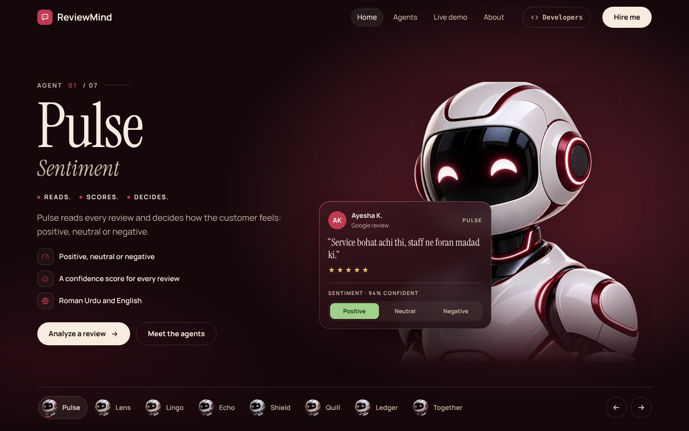
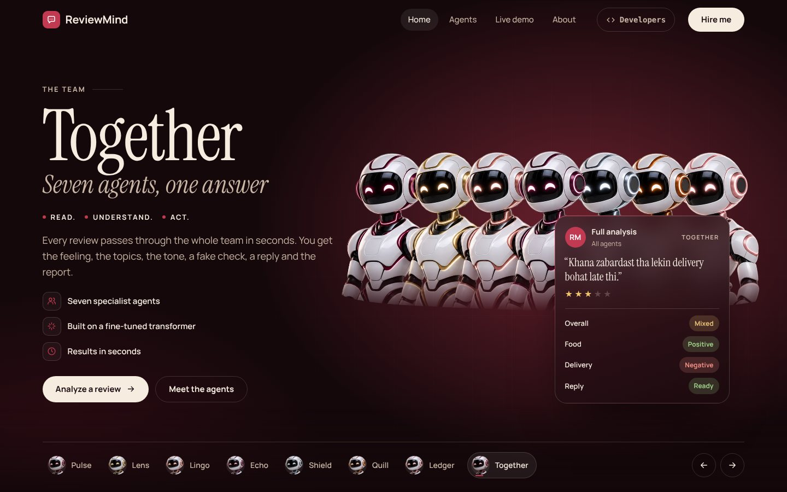
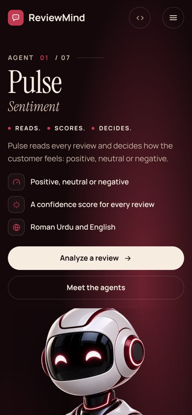
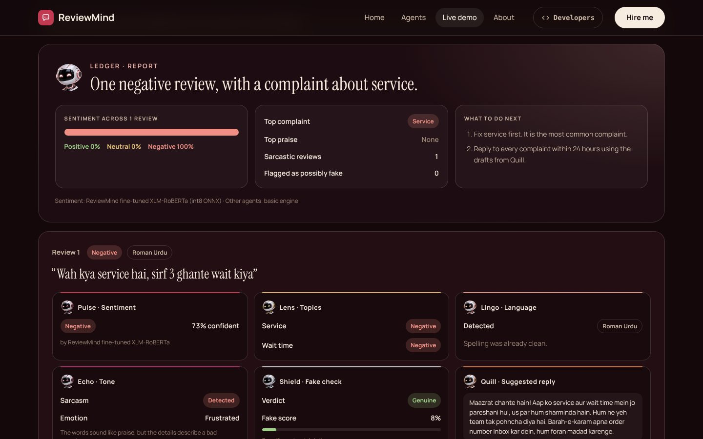
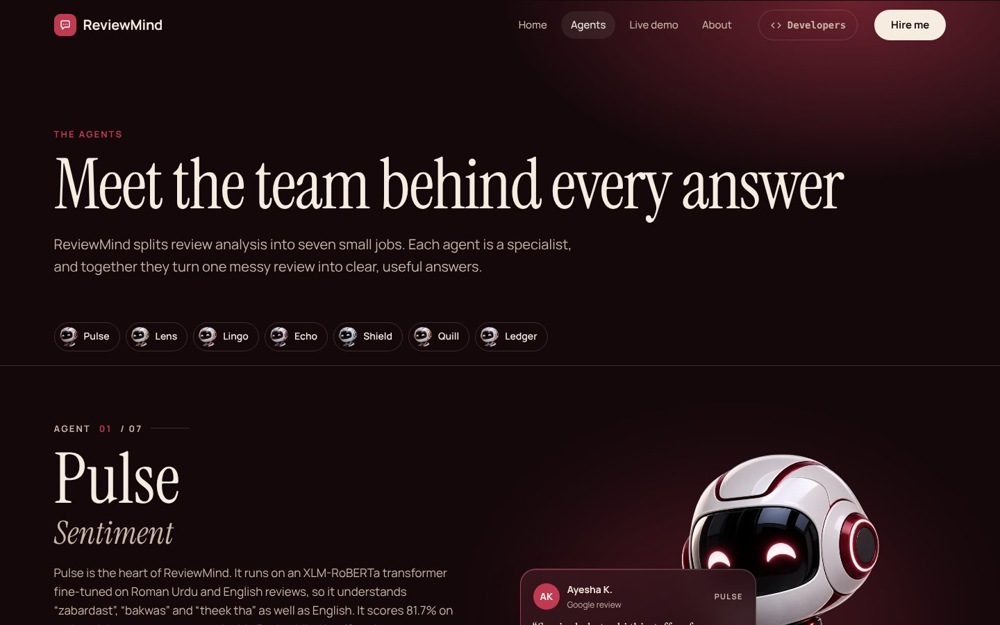
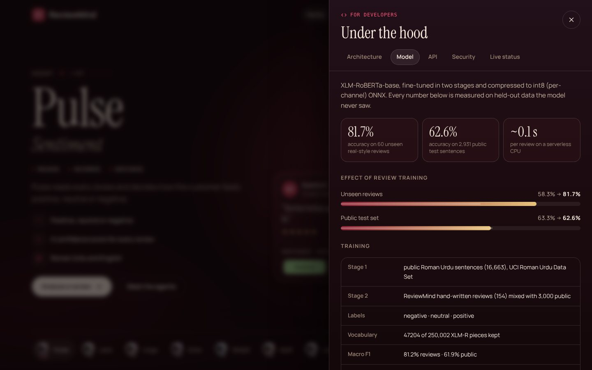

<div align="center">

# ReviewMind

**Seven AI agents that read customer reviews in Roman Urdu and English.**

[**Live site →**](https://reviewmindai.vercel.app) &nbsp;·&nbsp; [Live demo](https://reviewmindai.vercel.app/demo) &nbsp;·&nbsp; [API spec](https://reviewmindai.vercel.app/openapi.json)



      

</div>

ReviewMind turns messy reviews from Google, Daraz, Foodpanda and Instagram into clear answers: how the customer feels, what they are talking about, whether they are being sarcastic, whether the review is fake, a reply ready to send, and one report that says what to fix first.

The sentiment agent runs **our own fine-tuned XLM-RoBERTa model**: **81.7% accuracy** on 60 real-style reviews it never saw, running inside the API with no outside model service.

Built by **Nimra Imran**, AI Engineer.

## Screenshots

| The whole team | On a phone |
|---|---|
|  |  |

**Live demo:** sarcasm caught, topics split, reply drafted, report written



| Meet the agents | For developers panel |
|---|---|
|  |  |

---

## The agents

| Agent | Job | Engine |
|---|---|---|
| **Pulse** | Positive / neutral / negative with confidence | Own fine-tuned XLM-RoBERTa, int8 ONNX, runs inside the API |
| **Lens** | Topics (food, delivery, price…) each with its own verdict and evidence | Gemini, strict JSON schema |
| **Lingo** | Detects Roman Urdu / English / Urdu, fixes short forms (`bht → bohat`) | Rule-based normaliser + Gemini |
| **Echo** | Emotion and sarcasm (“Wah kya service hai, 3 ghante wait kiya”) | Gemini |
| **Shield** | Fake / spam score 0–100 with reasons | Gemini + rule-based signals |
| **Quill** | Reply draft in the customer’s own language | Gemini |
| **Ledger** | Batch report: sentiment split, top complaint, flagged reviews, next actions | Report builder + Gemini summary |

Lens, Lingo, Echo, Shield and Quill run in **one** Gemini call per batch to stay inside the free quota. If Gemini has no key, is rate-limited or is down, a **rule-based basic engine** answers instantly so the product never breaks; the response says which engine was used.

## Architecture

```
Browser (React + Vite)
   │  POST /api/analyze  { reviews[], business }
   ▼
Vercel function  ── validate · rate limit · origin check · 10-min cache
   │
   ├── Pulse model (ONNX/WASM) ── fine-tuned XLM-RoBERTa, in-process   [always on]
   ├── Gemini (JSON schema)   ── Lingo · Lens · Echo · Shield · Quill  [main]
   └── Basic engine           ── every agent, offline                 [fallback]
   ▼
Ledger report + per-review results + engine trace
```

## Pages

| Route | What it is |
|---|---|
| `/` | Hero with the seven agents (rotates every 10 s), how it works, the team |
| `/agents` | Each agent in detail with a live-looking example |
| `/demo` | Paste up to 10 reviews and watch the agents answer |
| `/about` | The problem, the tech stack, the API, and the builder |
| `/hire` | Hire Me form, delivered to your Gmail |

## Run locally

```bash
npm install
cp .env.example .env      # add your keys
npm run dev               # http://localhost:5173 (API runs inside Vite)
npm test                  # 27 tests: agents, pipeline, model helpers, API routes
npm run build
```

No key? `MOCK_GEMINI=1 npm run dev` runs the full UI with a deterministic mock, and with no variables at all the site runs in basic mode.

## Environment variables (Vercel → Settings → Environment Variables)

| Name | Required | What for |
|---|---|---|
| `GEMINI_API_KEY` | Yes, for full analysis | Free key from Google AI Studio |
| `GMAIL_USER` | Yes, for the Hire Me form | The Gmail address that sends the form |
| `GMAIL_APP_PASSWORD` | Yes, for the Hire Me form | A Gmail App Password (not your normal password) |
| `CONTACT_TO_EMAIL` | No | Send enquiries to another inbox |
| `GEMINI_MODEL` | No | Comma-separated model list to try in order |
| `PULSE_MODEL` | No | Set to `off` to skip the local sentiment model |

No email address or key is ever written in the code.

## API

`POST /api/analyze` · `POST /api/contact` · `GET /api/health`. Full reference: [`/openapi.json`](public/openapi.json) (OpenAPI 3.1, regenerate with `node scripts/build-openapi.mjs`).

```bash
curl -X POST https://<your-site>/api/analyze \
  -H 'content-type: application/json' \
  -d '{"reviews":["Khana zabardast tha lekin delivery bohat late thi"],"business":"Restaurant"}'
```

On the site, the **</> Developers** button (top bar or footer) opens a panel with the architecture, model metrics, API examples, security notes and live status.

## The sentiment model (Pulse)

Pulse runs our own **XLM-RoBERTa-base** model, fine-tuned in two stages and shipped inside the repository (`model/runtime/`, int8 ONNX split into two parts under GitHub's 100 MB limit). It runs in the Vercel function with `onnxruntime-web` (WebAssembly) and a SentencePiece tokenizer written in JavaScript, so there is no outside model service and no extra key.

| Test set (never seen in training) | Accuracy | Macro F1 |
|---|---|---|
| 60 real-style customer reviews (Roman Urdu, English, mixed) | **81.7%** | 81.2% |
| 2,931 public Roman Urdu sentences | 62.6% | 61.9% |

Review training lifted accuracy on unseen reviews from 58.3% to 81.7%. The public set is short social-media text with noisy labels, so its ceiling is lower. About 0.1 s per review on a serverless CPU. Full details and the training code: [`model/README.md`](model/README.md).

## Project structure

```
reviewmind/
├── api/                  Vercel functions: analyze, contact, health
│   └── _lib/             pipeline, Gemini client, Pulse model runner, basic engine, HTTP helpers
├── src/                  React app: pages, components, agent data, styles
├── public/               robot images, favicon, share card, openapi.json
├── model/
│   ├── runtime/          the shipped model (int8 ONNX parts, vocab, model card)
│   ├── training/         training, review tuning and export code
│   └── data/             sample reviews
├── docs/screenshots/     images used in this README
├── scripts/              OpenAPI spec builder
└── tests/                Vitest tests
```

## License

MIT © Nimra Imran
